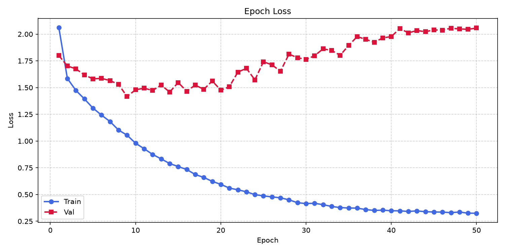
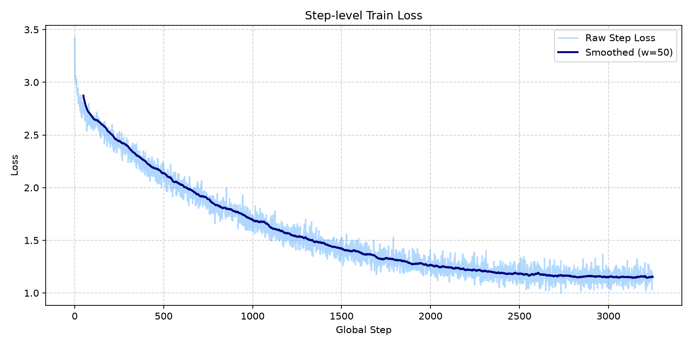
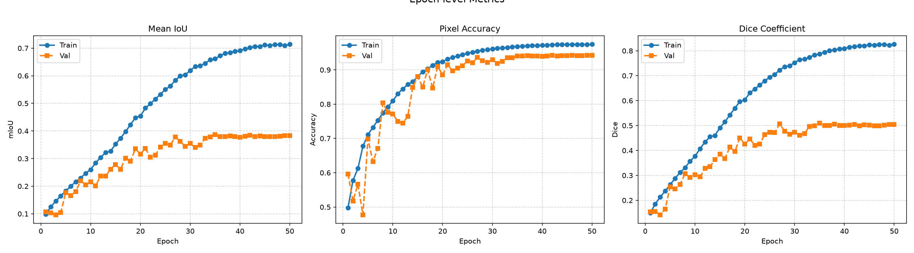
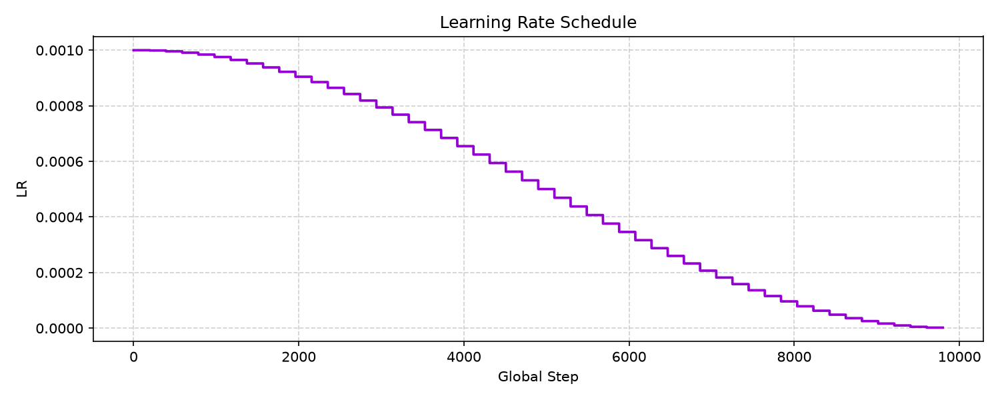
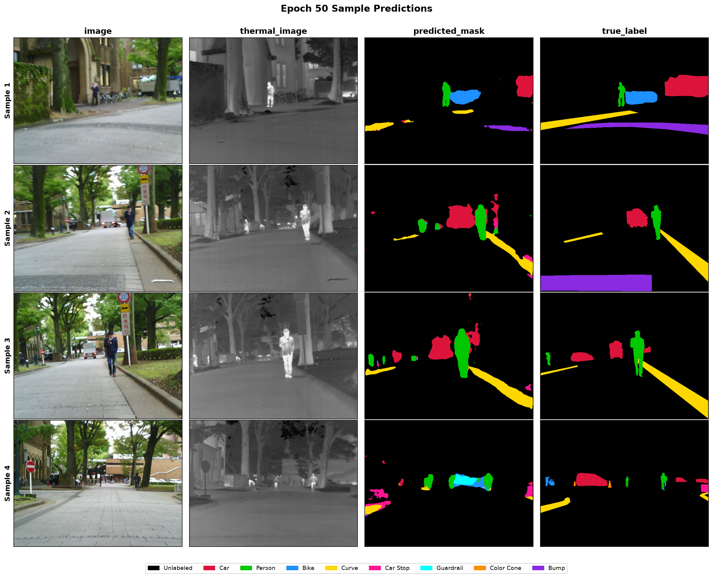
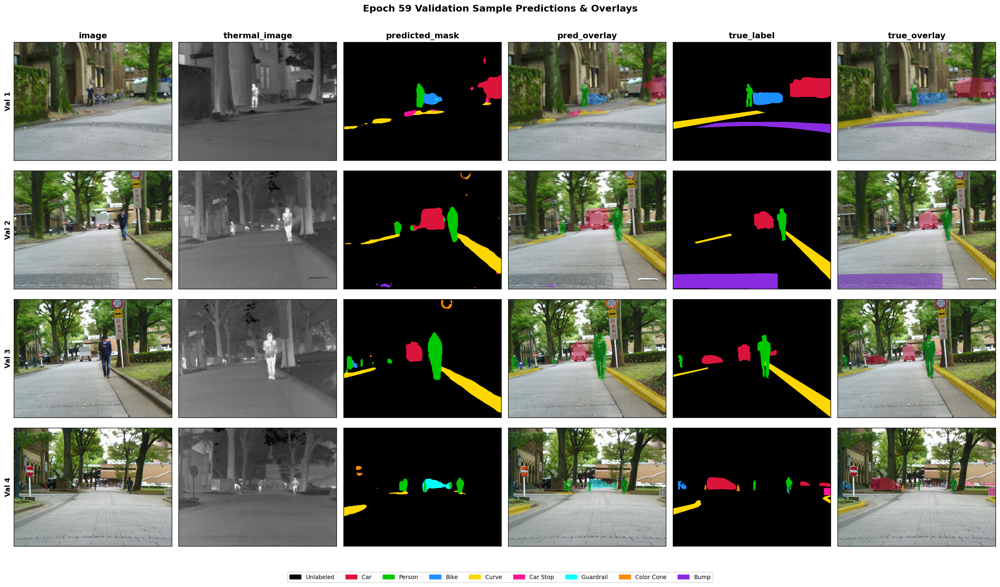
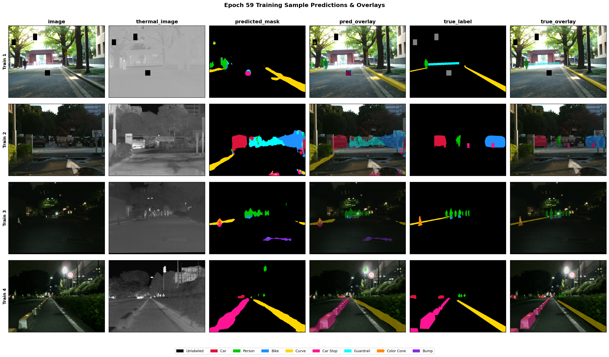

# RGB–Thermal Semantic Segmentation with MFNet

A PyTorch implementation of **multispectral semantic segmentation** that combines RGB imagery with thermal information. The repository implements an MFNet-style dual-encoder network, trains it on the MFNet dataset, and saves checkpoints, training curves, and prediction visualizations.

> **Scope:** This README describes the repository's `main` branch only.

## Overview

RGB cameras capture texture and color, while thermal imagery can provide useful cues in low-light and nighttime scenes. This project learns a dense, per-pixel segmentation from both modalities by encoding RGB and thermal features separately, fusing them, and decoding the fused representation into a nine-class segmentation map.

### Key features

- Separate RGB (3-channel) and thermal (1-channel) encoders.
- Mini-Inception blocks with standard and dilated convolutions for multiscale feature extraction.
- Feature fusion by channel concatenation and decoder skip connections.
- Pixel-wise predictions for **9 MFNet label IDs**.
- Combined weighted Cross-Entropy and multiclass Dice loss, with label smoothing and ignored-label support.
- Class-imbalance weighting, data augmentation, spatial dropout, gradient clipping, and early stopping.
- Optional CUDA automatic mixed precision (`--amp`) and `torch.compile` (`--compile`).
- Checkpoint saving and per-epoch visualization of train/validation predictions.

## Model architecture

The network is defined in [`model.py`](model.py).

1. **Input:** a tensor shaped `[B, 4, H, W]`; channels 0–2 are RGB and channel 3 is thermal.
2. **Separate feature extraction:** RGB and thermal encoders process each modality independently.
3. **Multiscale features:** convolution–batch normalization–LeakyReLU blocks and Mini-Inception blocks with dilated convolutions extract features.
4. **Fusion:** the deepest RGB and thermal feature maps are concatenated along the channel dimension.
5. **Decoder:** upsampling and skip connections combine fused features with intermediate features from both encoders.
6. **Output:** per-pixel logits shaped `[B, 9, H, W]`.

The default spatial dropout rate is `0.3`. The training script uses a default image size of **480 × 640** and nine output classes.

## Dataset

The implementation expects the MFNet dataset in this layout:

```text
MFNet_dataset/
├── images/       # 4-channel PNG images: RGB + thermal in channel 4
├── labels/       # Single-channel semantic label masks
├── train.txt     # Training sample names, without .png
├── val.txt       # Validation sample names, without .png
└── test.txt      # Optional test split
```

The code references the Kaggle dataset [`danialqashqai/mfnet-dataset`](https://www.kaggle.com/datasets/danialqashqai/mfnet-dataset). If the dataset is missing, the data loader attempts to download it automatically. Automatic download requires working Kaggle CLI credentials and access to the dataset; manual download is also supported.

### Label IDs

| ID | Class |
|---:|---|
| 0 | Unlabeled / Background |
| 1 | Car |
| 2 | Person |
| 3 | Bike |
| 4 | Curve |
| 5 | Car Stop |
| 6 | Guardrail |
| 7 | Color Cone |
| 8 | Bump |
| 255 | Ignore index — excluded from loss/metric computation |

Images and masks are resized to **480 × 640** by default. If Albumentations is installed, training augmentation includes horizontal flipping, brightness/contrast changes, affine transforms, coarse dropout, and blur. Validation is resized without the training augmentations.

## Installation

Python 3.10+ is a reasonable starting point; use a Python version supported by your installed PyTorch and Albumentations versions.

```bash
git clone https://github.com/pankaj-2708/Semantic-segmentation-using-RGB-and-thermal-image-.git
cd Semantic-segmentation-using-RGB-and-thermal-image-
python -m venv .venv
```

Activate the virtual environment:

**Windows PowerShell**
```powershell
.\.venv\Scripts\Activate.ps1
```

**Linux / macOS**
```bash
source .venv/bin/activate
```

Install dependencies:

```bash
python -m pip install --upgrade pip
python -m pip install -r requirements.txt
```

`requirements.txt` includes PyTorch, tqdm, uv, Matplotlib, NumPy, Kaggle, and Albumentations. For GPU acceleration, install a PyTorch build compatible with your NVIDIA driver and CUDA environment using the [official PyTorch installation selector](https://pytorch.org/get-started/locally/).

## Download the dataset

The downloader defaults to `../MFNet_dataset`:

```bash
python download_dataset.py
```

Choose another path with:

```bash
python download_dataset.py --output-dir ../MFNet_dataset
```

If automatic download fails, download and extract the dataset manually, then verify that `images/`, `labels/`, `train.txt`, and `val.txt` exist under the data root.

## Training

The default settings in `train.py` are:

| Setting | Default |
|---|---:|
| Architecture | MFNet |
| Input size | 480 × 640 |
| Number of classes | 9 |
| Batch size | 36 |
| Maximum epochs | 60 |
| Initial learning rate | 0.001 |
| Optimizer | AdamW |
| Weight decay | 0.02 |
| Label smoothing | 0.1 |
| Dropout | 0.3 |
| Early-stopping patience | 10 epochs |
| Gradient clipping | Maximum norm 10 |
| Learning-rate schedule | Cosine annealing; minimum LR 0.00001 |
| Class weighting | Automatic inverse cube-root frequency weighting |
| Mixed precision | Enabled by default on CUDA |
| `torch.compile` | Enabled by default on CUDA |

Start training using the default configuration:

```bash
python train.py
```

For a smaller GPU, try a smaller batch size:

```bash
python train.py --epochs 50 --batch-size 8
```

Other useful commands:

```bash
python train.py --help
python train.py --device cuda:0 --batch-size 8 --epochs 50
python train.py --no-amp --no-compile
python train.py --resume checkpoints/best_checkpoint.pt --epochs 60 --lr 1e-4 --lr-mode restart
```

The default device is `cuda:0` when CUDA is available; otherwise, it falls back to CPU. AMP and compilation are used only when the selected device is CUDA. Validation mIoU is the default model-selection and early-stopping metric.

## Loss function

The training objective combines weighted Cross-Entropy loss and multiclass Dice loss:

```text
L_total = L_weighted_CE + L_Dice
```

Both components have a default weight of `1.0`.

- **Weighted Cross-Entropy:** uses automatic class weights by default to reduce the effect of MFNet's severe class imbalance. Label smoothing defaults to `0.1`.
- **Multiclass Dice loss:** measures soft overlap between predicted class probabilities and the ground-truth masks.
- **Ignore index:** pixels labelled `255` are masked out of the loss and excluded from confusion-matrix metrics.

The class-weighting scheme can be changed with `--class-weights auto`, `--class-weights mfb`, `--class-weights enet`, or `--class-weights none`.

## Results and visualizations

The `main` branch contains a saved `checkpoints/best_checkpoint.pt` and per-epoch prediction visualizations for epochs **1–59**, along with aggregate training plots. The training code records the following values at step and epoch level:

- **Training loss and validation loss** — the combined Cross-Entropy + Dice objective; lower is generally better when comparing the same evaluation setup.
- **Mean Intersection over Union (mIoU)** — the default model-selection metric.
- **Pixel accuracy** — fraction of evaluated pixels classified correctly.
- **Mean Dice coefficient** — overlap/F1-style score.
- **Per-class IoU and Dice** — scores for each semantic label.
- **Learning rate** — tracked during optimization.

### Training and validation loss

This chart is generated by the repository's training script and shows the recorded epoch-level train and validation loss:



Step-level training loss is available here:



### Segmentation metrics

The epoch metrics figure plots train and validation **mIoU, pixel accuracy, and Dice**:



The learning-rate schedule is also recorded:



### Prediction examples

The combined prediction image compares RGB input, thermal input, predicted mask, prediction overlay, ground-truth mask, and ground-truth overlay:



Validation-only examples:



Training-only examples:



### Exact numeric metrics

The checked-in checkpoint stores a `history` object (including epoch-level train/validation loss, mIoU, pixel accuracy, Dice, and per-class scores) and `best_metric_val` / `best_epoch` metadata. The repository also includes plot images, but does not include a separate human-readable CSV or JSON history file. To print the checkpoint's exact recorded best epoch and metrics, run this from the repository root:

```python
import torch

checkpoint = torch.load(
    "checkpoints/best_checkpoint.pt",
    map_location="cpu",
    weights_only=False,
)

print("Best epoch:", checkpoint.get("best_epoch"))
print("Best validation metric (mIoU):", checkpoint.get("best_metric_val"))

history = checkpoint.get("history", {})
for split in ("train_epoch", "val_epoch"):
    rows = history.get(split, [])
    if rows:
        row = rows[-1]
        print(f"\\n{split} — last recorded epoch {row.get('epoch')}")
        for key in ("loss", "miou", "pixel_acc", "dice"):
            print(f"  {key}: {row.get(key)}")

# Best validation epoch row and matching training row
val_rows = history.get("val_epoch", [])
if val_rows:
    best_epoch = checkpoint.get("best_epoch")
    best_val = next((r for r in val_rows if r.get("epoch") == best_epoch), None)
    print("\\nBest validation epoch metrics:", best_val)
    train_row = next(
        (r for r in history.get("train_epoch", []) if r.get("epoch") == best_epoch),
        None,
    )
    print("Training metrics at that epoch:", train_row)
```

This avoids quoting loss or score values by visually estimating them from a plot. The saved curves and checkpoint provide complementary views of training progress and the selected model.

## Checkpoints and output files

| Path | Purpose |
|---|---|
| `checkpoints/best_checkpoint.pt` | Best checkpoint according to validation mIoU |
| `plots/epoch_XXX_predictions.png` | Combined training/validation prediction comparison for an epoch |
| `plots/epoch_XXX_train_predictions.png` | Training prediction examples for an epoch |
| `plots/epoch_XXX_val_predictions.png` | Validation prediction examples for an epoch |
| `plots/epoch_loss.png` | Epoch-level train/validation loss |
| `plots/epoch_metrics.png` | Epoch-level mIoU, pixel accuracy, and Dice |
| `plots/step_train_loss.png` | Step-level training loss |
| `plots/learning_rate.png` | Learning-rate schedule |
| `plots/latest_predictions.png` | Latest combined prediction visualization |
| `plots/latest_train_predictions.png` | Latest training visualization |
| `plots/latest_val_predictions.png` | Latest validation visualization |

Saved checkpoints contain model weights, optimizer and scheduler state, training history, best-metric metadata, a configuration snapshot, and random-number-generator states. Training can be resumed with `--resume`.

## Project structure

```text
.
├── model.py                 # MFNet model architecture
├── dataset.py               # Dataset loading, transforms, and DataLoaders
├── download_dataset.py      # Kaggle dataset download helper
├── train.py                 # Training loop, loss, metrics, checkpointing, plots
├── requirements.txt         # Python dependencies
├── cmds.md                  # GPU setup and command examples
├── checkpoints/
│   └── best_checkpoint.pt   # Saved best checkpoint (tracked on main)
└── plots/
    ├── epoch_XXX_predictions.png
    ├── epoch_XXX_train_predictions.png
    ├── epoch_XXX_val_predictions.png
    ├── epoch_loss.png
    ├── epoch_metrics.png
    ├── step_train_loss.png
    └── learning_rate.png
```

## Notes and limitations

- This is an MFNet-style RGB–thermal segmentation implementation; results depend on the data split, device, training options, and software versions.
- Qualitative prediction images do not replace evaluation on a held-out test set.
- The training script builds training and validation DataLoaders; although the dataset format documents a test split, a separate test-set evaluation is not reported by default.
- The model returns logits. Use `argmax(dim=1)` to obtain the predicted class ID per pixel.

## Reference

The implementation cites the paper *MFNet: Towards Real-Time Semantic Segmentation for Autonomous Vehicles with Multi-Spectral Scenes* (IROS 2017). See the [MFNet research paper/project reference](https://github.com/haqishen/MFNet).

## License

No license file was found in the inspected `main` branch. Check the repository owner's intended license before reusing or redistributing this code.
