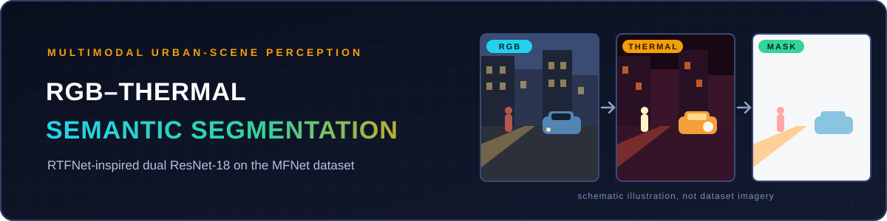
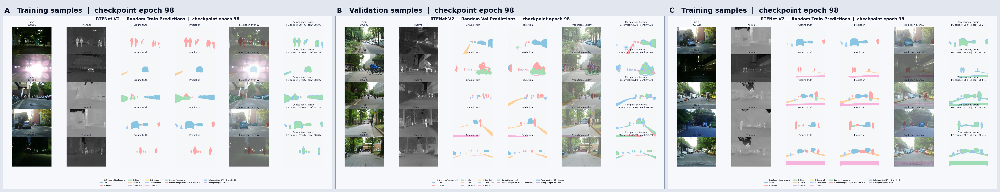
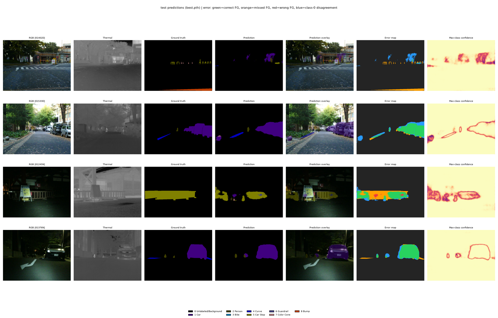
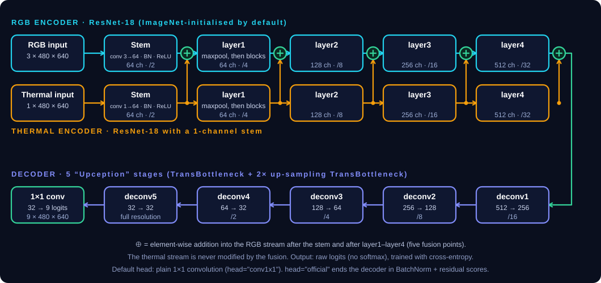
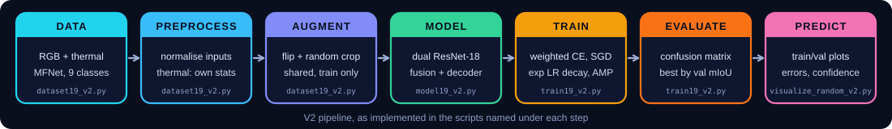
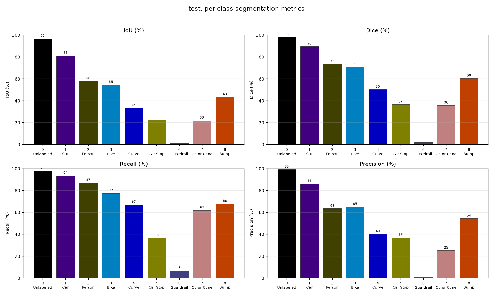
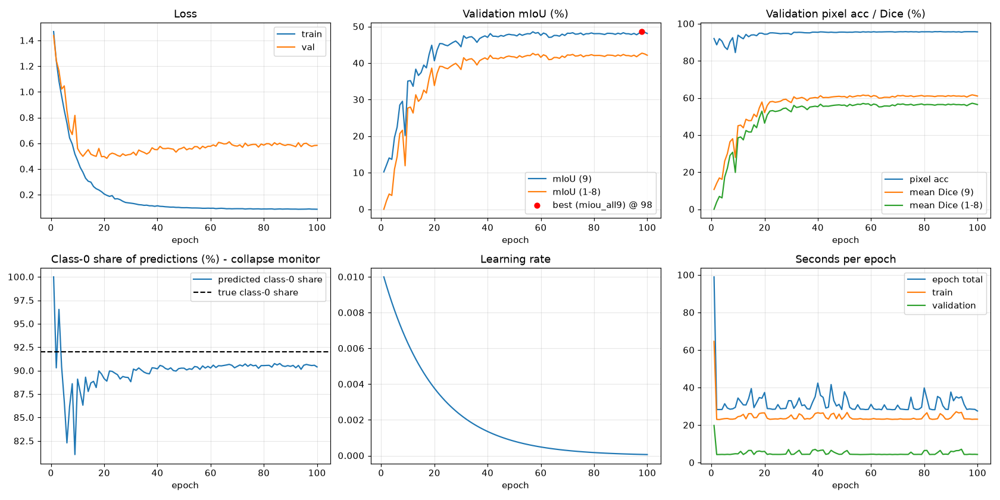
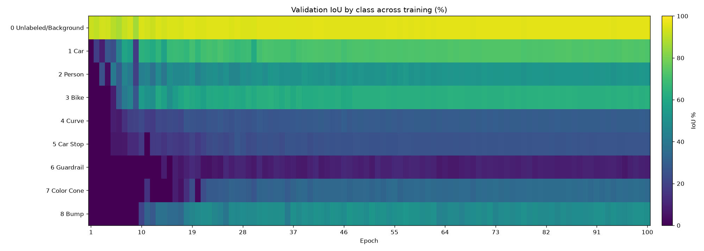

<p align="center">
  
</p>

<p align="center">
  <b>Semantic segmentation of urban scenes from paired RGB and thermal images, using an RTFNet-inspired dual ResNet-18 in PyTorch.</b>
</p>

<p align="center">
  <sub><a href="#qualitative-prediction-results">Predictions</a> · <a href="#model-architecture">Architecture</a> · <a href="#dataset-and-input-modalities">Dataset</a> · <a href="#model-variants-and-experiments">Variants</a> · <a href="#training-pipeline-and-losses">Training</a> · <a href="#quantitative-results">Results</a> · <a href="#installation-and-commands">Commands</a> · <a href="#limitations-and-future-work">Limitations</a></sub>
</p>

## Overview

A thermal camera sees warm objects such as people and vehicles in the dark or in glare, where an RGB camera struggles. This project labels every pixel of an urban scene (car, person, bike, curb, car stop, guardrail, color cone, bump, or background) from an RGB image and a thermal image taken together. It is my personal copy of my work on the team's `model/19` branch.

- **Two-stream network:** separate ResNet-18 encoders for RGB and thermal, fused by addition at five depths, with a five-stage decoder.
- **Documented training setup:** class-weighted cross-entropy for the 92% background imbalance, a collapse monitor, and checkpoint selection by validation mIoU.
- **Evaluation tooling:** whole-set confusion-matrix metrics (mIoU over 9 classes and over 8 foreground classes), per-class plots, and random-sample prediction figures.

> This is an *RTFNet-inspired* model. It does not reproduce a published RTFNet benchmark and is not compared against one here.

## Qualitative Prediction Results



<sub>Click the image to open it at full resolution (5845 × 1123 px).</sub>

Three figures from `visualize_random_v2.py`, all using the epoch-98 checkpoint of the V2 model. **A** and **C** show random *training* samples and **B** shows random *validation* samples. In each figure the rows are scenes and the columns are RGB, thermal, ground truth, prediction, prediction overlay, and an error map (green is correct foreground, red is missed foreground, blue is a false positive, purple is a wrong foreground class), with the per-sample foreground-correct percentage and mean confidence.

These are **qualitative examples, not numerical evaluation results.** The training samples are expected to look better than unseen data: the per-sample "FG correct" values printed in the screenshots are about 96–98% for the training panels and about 64–82% for the validation panel.

<details>
<summary>Test-split predictions with error maps and confidence (downscaled copy)</summary>



</details>

## Model Architecture



- **Encoders:** two ResNet-18 networks (torchvision). RGB uses a 3-channel stem and thermal a 1-channel stem. The thermal stem is initialised from the mean of the RGB filters, and both load ImageNet weights by default.
- **Fusion:** thermal features are added element-wise into the RGB stream after the stem and after `layer1` to `layer4`. The thermal stream itself is never modified.
- **Decoder:** five "Upception" stages (a plain bottleneck plus a 2× up-sampling bottleneck) with channels 512 → 256 → 128 → 64 → 32.
- **Head:** the V2 default is a plain 1×1 convolution to 9 logits. The original `official` head (BatchNorm and residual on the class scores) is still available with `--head official`.
- **Shapes:** RGB `[B, 3, 480, 640]` and thermal `[B, 1, 480, 640]` in, logits `[B, 9, 480, 640]` out. Inputs not divisible by 32 are padded internally.

## Dataset and Input Modalities

The data is **MFNet**: urban scenes captured as aligned RGB and thermal frames at 640 × 480, split into 784 train, 392 validation and 393 test images, with 9 label classes. The raw download stores RGB and thermal together in one 4-channel PNG (thermal in the fourth channel), and `dataset19_v2.py` also reads a prepared `RGB/Thermal/Label` layout. RGB is normalised with ImageNet statistics and thermal with statistics computed from the dataset.

| Id | Class | Train pixel share |
|:---:|:---|---:|
| 0 | Unlabeled / background | 92.14% |
| 1 | Car | 4.14% |
| 2 | Person | 1.20% |
| 3 | Bike | 0.92% |
| 4 | Curve | 0.59% |
| 5 | Car stop | 0.45% |
| 6 | Guardrail | 0.09% |
| 7 | Color cone | 0.18% |
| 8 | Bump | 0.29% |

The pixel shares are printed by `python dataset19_v2.py --diagnose`. Augmentation (training only) is a synchronised horizontal flip (p = 0.5) and a random crop that keeps at least 90% of each side, applied identically to RGB, thermal and label.

## Model Variants and Experiments

| | V1 | V2 (this README) |
|:---|:---|:---|
| **Files** | earlier scripts, outputs in `checkpoints/model19` and `plots/model19` | `model19_v2.py`, `dataset19_v2.py`, `train19_v2.py`, `visualize_random_v2.py` |
| **Head** | `official`: BatchNorm and residual on the class scores | `conv1x1` by default (a hypothesis-driven change, not a proven fix) |
| **Added in V2** | | optional class-prior bias, optional frozen encoder BatchNorm, thermal-init choice, local pretrained weights, dataset diagnostics, class weights, per-class and class-0 monitoring |

The V2 code documents the encoder and fusion as unchanged from V1. Separate run folders exist under `plots/` (`model19`, `model19_v2`, `model19_v2_ada16gb`). **The only complete evidence reported here comes from one V2 run** (100 epochs, best checkpoint at epoch 98). No head-to-head comparison between V1, V2 or any other architecture is included, so no claim is made that one is better.

## Training Pipeline and Losses



| Setting | Default in `train19_v2.py` |
|:---|:---|
| Loss | cross-entropy with class weights `inv_sqrt` (from train pixel frequencies, max/min ratio ≤ 20, mean 1). Class 0 is included, with no ignore index. Dice is available with `--dice-weight` (off) |
| Optimiser | SGD, learning rate 0.01, momentum 0.9, weight decay 5e-4 |
| Scheduler | exponential decay, × 0.95 per epoch |
| Batch | 2 per step, 4 accumulation steps (effective batch 8) |
| Precision | mixed precision automatically on CUDA |
| Epochs / seed | 100 / 42 |
| Selection | best checkpoint by validation mIoU over 9 classes (`--select-metric auto`) |
| Evaluation | one confusion matrix over the whole set, giving mIoU (9) and mIoU (1–8), plus Dice and pixel accuracy. Pixels labelled 255 are ignored |

The shown learning-rate curve (0.01 falling to about 6e-5 at epoch 100) matches 0.01 × 0.95^(epoch−1). The exact command line of the plotted run is not recorded in the files used for this README.

## Quantitative Results

All numbers below are for the **test split**, evaluated with `best.pth` from the V2 run. They are read from the chart labels of `test_classwise_metrics.png` (rounded to whole percent) and come from a single run and a single seed.

| Class | IoU | Dice | Recall | Precision |
|:---|---:|---:|---:|---:|
| 0 Unlabeled / background | 97 | 98 | 98 | 99 |
| 1 Car | 81 | 90 | 94 | 86 |
| 2 Person | 58 | 73 | 87 | 63 |
| 3 Bike | 55 | 71 | 77 | 65 |
| 4 Curve | 34 | 50 | 67 | 40 |
| 5 Car stop | 22 | 37 | 36 | 37 |
| 6 Guardrail | ≈1 | ≈2 | 7 | ≈1 |
| 7 Color cone | 22 | 36 | 62 | 25 |
| 8 Bump | 43 | 60 | 68 | 54 |

Averaging the rounded IoU values gives roughly **46% mIoU over 9 classes** and **40% over the 8 foreground classes**. During training the validation mIoU (9) plateaus at about 48% and mIoU (1–8) at about 42%, read from the curves below. The test and validation figures are different splits and are not directly comparable.



## Training Plots and Interpretation



- **Loss and overfitting:** training loss keeps falling to about 0.09, while validation loss bottoms out near 0.48 around epoch 20 and drifts up to about 0.58. Validation mIoU does not fall, so the best checkpoint (epoch 98) is chosen by mIoU, not by loss.
- **mIoU plateau:** mIoU rises quickly until roughly epoch 40, then stays almost flat.
- **Pixel accuracy is misleading here:** it sits near 0.955–0.96 because background is about 92% of pixels.
- **Collapse monitor:** the share of pixels predicted as class 0 starts at 100% (the epoch-1 prediction figure is all background) and settles around 90–91%, just under the true 92%.
- **Time:** about 30 s per epoch after the first, with validation about 5 s. The GPU is not recorded in these files.



Car, bike and bump are learned first and most steadily. Guardrail stays below roughly 10% IoU for the whole run.


In the row-normalised confusion matrix, 86% of guardrail pixels are predicted as background, and car stop is split between correct (36%), background (32%) and guardrail (21%). The first row label is clipped in the original plot.

## Installation and Commands

No dependency manifest was available while writing this README. The V2 scripts import PyTorch, torchvision, NumPy, Pillow and Matplotlib, and use `tqdm` if it is installed. Install the PyTorch build that matches your CUDA setup, then:

```powershell
python -m venv .venv
.venv\Scripts\Activate.ps1
pip install torch torchvision numpy pillow matplotlib tqdm
```

**Dataset.** The team's helper `download_dataset.py` downloads MFNet with `gdown` from a Google Drive folder (`18BQFWRfhXzSuMloUmtiBRFrr6NSrf8Fw`); `dataset.py` also lists the Kaggle mirror `danialqashqai/mfnet-dataset`. Automatic download can fail, so manual download is the fallback. The V2 scripts auto-detect `..\MFNet_dataset` (raw layout with `images/`, `labels/`, `train.txt`, `val.txt`, `test.txt`) or `..\MFNet_CMX` (prepared `RGB/`, `Thermal/`, `Label/`). Use `--data-root` for any other location.

```powershell
python download_dataset.py --output-dir ..\MFNet_dataset   # optional helper
python dataset19_v2.py --diagnose                           # checks labels, alignment, class shares; writes preview plots
python model19_v2.py --real-batch                           # forward-pass shape test on a real batch (synthetic without the flag)
python train19_v2.py --sanity                               # real-data sanity checks, then exits
python train19_v2.py --epochs 100                           # train, validate every epoch, test once at the end
python train19_v2.py --epochs 100 --resume                  # continue from checkpoints\model19_v2\last.pth
python train19_v2.py --eval-only --eval-split test         # evaluate best.pth without training
python visualize_random_v2.py --checkpoint checkpoints\model19_v2\best.pth --num-samples 5
```

- Use `--run-name NAME` to keep runs in separate folders: checkpoints go to `checkpoints\NAME\` and plots to `plots\NAME\`.
- There is no separate inference script. `visualize_random_v2.py` opens matplotlib windows with random train and validation samples (it does not save files, and the default checkpoint is `checkpoints\model19_v2_ada16gb\best.pth`, so pass `--checkpoint`).
- `train19_v2.py` also writes `history.json`, `history.csv` and `test_results.json` next to the checkpoints.

## Project Structure

```text
.
├── model19_v2.py            # RTFNet-inspired dual ResNet-18 (V2)
├── dataset19_v2.py          # MFNet loader, validation, diagnostics, augmentation
├── train19_v2.py            # training, evaluation, plots
├── visualize_random_v2.py   # random train/val prediction figures
├── model.py · dataset.py · train.py · download_dataset.py   # team baseline files
├── plots/                   # model19, model19_v2, model19_v2_ada16gb
├── RTFNet_V2_visualization/ · RTFNET_predicted_mask_results/
├── assets/readme/           # banner, diagrams, selected plots, prediction triptych
└── checkpoints/ · datasets  # kept out of Git
```

## Limitations and Future Work

- **Rare structures are weak:** guardrail is essentially not learned, and car stop, color cone and curve are far below car and person. Rare classes are also over-predicted compared with their true pixel share.
- **Overfitting signs:** the training and validation loss gap and the training-versus-validation sample gap above. MFNet is a small dataset.
- **Single run:** one seed, no confidence intervals, no RGB-only or thermal-only ablation, and no comparison with other architectures or published results.
- **Metrics are read from charts** (rounded). The exact values are in `test_results.json` and `history.json` in the run folder.
- **Possible next steps:** compare `--head` options and `--prior-bias`, try `--dice-weight`, run an RGB-only ablation, repeat with several seeds, and compare teammates' models on the same splits.

## Technologies and Acknowledgements

Python, PyTorch, torchvision, NumPy, Pillow and Matplotlib. The architecture follows Sun et al., *RTFNet: RGB-Thermal Fusion Network for Semantic Segmentation of Urban Scenes* (IEEE RA-L, 2019) and its official code. The MFNet dataset and the team baseline files belong to their respective authors; please follow the dataset's own licence and citation requirements.

<p align="center"><sub>Built by <b>Pankaj</b> · <a href="https://github.com/Pankaj-Jhajhria/RGB-T-Semantic-Segmentation">Pankaj-Jhajhria/RGB-T-Semantic-Segmentation</a></sub></p>
